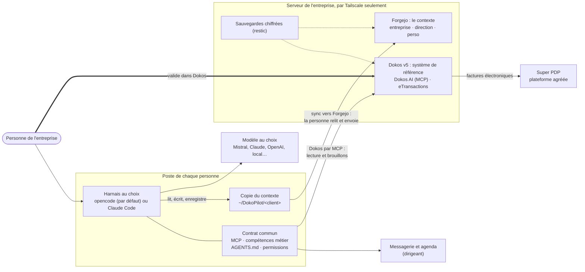

# DokoPilot V2

Installation unifiée, en infrastructure as code, d'un environnement de gestion agentique pour une
TPE ou PME française :

- **Dokos v5 non modifié** (ERP libre), avec ses applications **Dokos AI** (serveur MCP,
  validations, journal) et **eTransactions** (facturation électronique par la plateforme agréée
  Super PDP) ; les relevés bancaires sont importés dans Dokos ;
- **Forgejo** (serveur Git libre) sur le même serveur, avec le **contexte de l'entreprise** déjà
  découpé en dépôts : `<client>/entreprise` (toute l'entreprise), `<client>/direction` (le
  dirigeant et son assistant) et `<client>/perso-<id>` (un par personne), avec une arborescence
  fixe (`00-Boite-de-reception` à `90-Modeles`) et huit règles pour les agents (`AGENTS.md`) ;
- sur un **serveur auto-hébergé au nom de l'entrepreneur** (Debian 13), durci, joignable
  **uniquement par Tailscale** en production, avec un accès de maintenance SSH nominatif (clé,
  sudo, fail2ban) et des **sauvegardes chiffrées** (Dokos et Forgejo) ;
- et, sur le **poste de chaque personne**, un **harnais d'agent au choix** (opencode par défaut,
  Claude Code en option) qui travaille dans `~/DokoPilot/<client>`, sa copie du contexte, branché
  sur Dokos par MCP pour le dirigeant, avec des compétences métier en français.

L'agent prépare, l'humain valide. Dans Dokos, l'utilisateur « assistant » du dirigeant lit et crée
des brouillons, mais ne peut ni valider, ni annuler, ni supprimer un document ; en version 0.2,
seul l'assistant du dirigeant entre dans Dokos ([D-29](docs/decisions.md)). Dans le contexte,
l'agent enregistre ses modifications sur le poste (commits « Assistant de <Prénom> ») et ne les
envoie jamais : la personne les relit, puis les envoie avec `bin/dokopilot sync`. La caisse
certifiée n'est pas concernée.

Tout se règle dans **un seul fichier par client** (`clients/<client>/client.yml`) et **un fichier
de secrets chiffré** (`secrets.yml.age`) ; un script installe tout, en posant les questions.

## En un coup d'œil



Les agents préparent : brouillons dans Dokos, enregistrements dans la copie du contexte. Une
personne valide dans Dokos et envoie le contexte avec `bin/dokopilot sync`. Le schéma détaillé
(conteneurs, ports, accès de maintenance) est dans [`docs/architecture.md`](docs/architecture.md).

## Démarrage rapide

Sur une Debian 13 fraîchement installée, qui devient le serveur (une VM de test suffit), ou sur le
poste qui pilotera un serveur distant, avec votre compte personnel (pas root) :

```bash
command -v curl || sudo apt install -y curl     # Debian n'installe pas toujours curl
curl -fsSL https://raw.githubusercontent.com/GDS-42/DokoPilotV2/v0.2.0/install.sh | sh
```

Variante plus prudente : télécharger le script, le lire, puis le lancer.

```bash
curl -fsSLO https://raw.githubusercontent.com/GDS-42/DokoPilotV2/v0.2.0/install.sh
less install.sh
sh install.sh
```

Le script vérifie la machine, installe ce qui manque avec `apt` ou `dnf` après vous l'avoir
demandé (`git`, `python3` et `venv`, `age`, client OpenSSH, `make`, `curl`), récupère DokoPilot à
la version `v0.2.0` dans `~/DokoPilotV2`, lance `make setup`, puis l'assistant d'installation, qui
pose ses questions en français et installe tout avec `bin/dokopilot`. Si l'installation
s'interrompt, relancez la même commande : l'assistant reprend où il s'était arrêté. Le
déroulé complet et la liste des questions sont dans [docs/installation.md](docs/installation.md).

| Option de `install.sh` | Effet |
| --- | --- |
| `--check` | Vérifie seulement cette machine, sans rien installer : `sh install.sh --check` |
| `--answers <fichier>` | Répond aux questions avec un fichier, sans rien demander (modèle commenté : [`installer/answers.example.yml`](installer/answers.example.yml)) |
| `--yes` | Répond oui aux confirmations dont la réponse proposée est oui (jamais au remplacement d'une installation existante) |
| `--version <étiquette>` | Autre version de DokoPilot (défaut : `v0.2.0`) |
| `--dir <dossier>` | Autre dossier pour DokoPilot (défaut : `~/DokoPilotV2`) |

### Deux modes

| Mode | Où lancer le script | Prérequis |
| --- | --- | --- |
| **Tout sur cette machine** | La machine qui sera le serveur | Debian 13 **amd64** ; 8 Go de mémoire (au moins 7,5 Gio visibles) ; 30 Go libres dans `/var` (40 conseillés) ; votre compte personnel, avec sudo et un mot de passe. Ce compte devient le compte de maintenance ; son mot de passe ne change pas, sudo vous le demande (invite « BECOME password » d'Ansible) |
| **Serveur distant** | Votre poste, qui pilote le serveur en SSH | Poste : Debian 13, Ubuntu 24.04 ou plus récent (WSL compris), Fedora 41 ou plus récent, en x86_64 ou aarch64, 2 Go de mémoire et 2 Go libres, Python 3.12 ou plus. Serveur : Debian 13 amd64 (4 vCPU, 8 Go de mémoire, 40 Go de disque en démonstration, 80 Go en production), joignable en SSH avec un compte initial qui a sudo |

Dans les deux cas, la machine qui lance le script doit joindre GitHub, PyPI et Ansible Galaxy ;
celle qui devient le serveur doit joindre en plus les dépôts Debian et Docker, les registres de
Dokos (GitLab), de Docker Hub et de Forgejo (Codeberg), npm et, en mode Tailscale, les paquets
et le service de Tailscale. `sh install.sh --check` vérifie l'accès aux sites nécessaires et dit
si le mode « tout sur cette machine » est possible.

**Les agents eux-mêmes** (opencode, Claude Code) ne sont pas installés par le script :
installez-les depuis les installateurs de leurs éditeurs
([docs/poste-entrepreneur.md](docs/poste-entrepreneur.md), « 1. Préparer l'ordinateur »). Le
résumé de fin d'installation liste ce qui manque encore sur le poste (opencode, Claude Code,
bubblewrap et socat pour son bac à sable, uv et Node.js pour la messagerie et l'agenda).

Pour essayer sur une VM : [docs/vm-locale.md](docs/vm-locale.md), ou
[docs/vm-hyperv.md](docs/vm-hyperv.md) sous Windows. En démonstration, l'identifiant proposé est
`atelier-demo` : l'« Atelier Démo » est une entreprise fictive avec ses clients, fournisseurs,
articles, factures, factures électroniques reçues, relevé bancaire et un contexte d'exemple
([docs/donnees-de-test.md](docs/donnees-de-test.md)).

## Installer chez un client

1. L'entrepreneur loue un serveur Debian 13 amd64 à son nom, crée un réseau Tailscale et un
   dépôt de sauvegarde distant ([docs/installation.md](docs/installation.md), « Avant de
   commencer »).
2. Sur le poste qui pilote l'installation : `sh install.sh`, mode « serveur distant », profil
   « production » (SIREN, clé Tailscale et dépôt de sauvegarde demandés). Le chemin manuel
   (`bin/dokopilot init`, `config`, `bootstrap`, `install`, `harness`, `check`) reste possible.
3. Ajoutez les identifiants Super PDP (`bin/dokopilot secrets <client> edit`), puis relancez
   `bin/dokopilot install <client>`.
4. Sur le poste de chaque personne : `bin/dokopilot harness <client> --person <id>`
   ([docs/poste-entrepreneur.md](docs/poste-entrepreneur.md)).

## Commandes

Elles se lancent depuis le dossier de DokoPilot (`~/DokoPilotV2` par défaut). En mode « tout sur
cette machine », ajoutez `--local -K` aux commandes qui passent par Ansible (`install`, `check`,
`harness`, `backup`, `restore`, `demo-reset`) : `-K` fait demander votre mot de passe sudo.

| Commande | Rôle |
| --- | --- |
| `bin/dokopilot doctor` | Vérifier les outils du poste |
| `bin/dokopilot init <client>` | Créer ou compléter la configuration, la clé age et les secrets chiffrés |
| `bin/dokopilot config <client>` | Valider la configuration et l'afficher, sans rien changer |
| `bin/dokopilot bootstrap <client> -K` | Premier passage sur un serveur distant, avec son compte initial |
| `bin/dokopilot install <client>` | Installer ou mettre à jour tout le serveur (se relance sans risque) |
| `bin/dokopilot check <client>` | Contrôles de fonctionnement et de sécurité, sans rien modifier |
| `bin/dokopilot harness <client> [--person <id>]` | Configurer le harnais et les copies du contexte sur ce poste |
| `bin/dokopilot sync <client> [--person <id>] [--yes]` | Recevoir les changements de Forgejo, montrer ce qui va partir, puis l'envoyer après accord |
| `bin/dokopilot backup <client>`, `restore <client> --confirm` | Sauvegarder maintenant, restaurer |
| `bin/dokopilot demo-reset <client>` | Recharger les données de test (profil demo) |
| `bin/dokopilot secrets <client> edit\|show <clé>\|keys` | Lire ou modifier les secrets chiffrés |
| `bin/dokopilot ssh <client> [--tunnel]` | Ouvrir une session de maintenance (serveur distant) |

## Le dépôt

| Chemin | Contenu |
| --- | --- |
| `install.sh` | L'installation en une commande : vérifications, paquets, copie de DokoPilot, `make setup`, assistant |
| `installer/` | L'assistant d'installation (`wizard.py`, questions en français, reprise) et le modèle de fichier de réponses |
| `bin/dokopilot` | La commande unique (voir plus haut) |
| `config/` | Référence commentée de la configuration d'un client et modèle des secrets |
| `clients/` | Un dossier par client ; seul `demo` est versionné |
| `ansible/roles/config` | Fusionne valeurs par défaut, profil et réglages du client dans le fait `dp` et les valide ; les autres rôles ne lisent que `dp` |
| `ansible/roles/*` | Système (base, maintenance, ssh, firewall, fail2ban, tailscale, docker, proxy), Dokos (dokos, dokos_config, demo_data, backup), harnais du poste (harness) |
| `ansible/roles/forgejo` | Forgejo : projet Compose, comptes, organisation, équipes, dépôts, jetons, contrôles |
| `ansible/roles/context` | Dépôt du contexte initial dans les dépôts vides |
| `ansible/playbooks/` | `site.yml` (tout), `bootstrap.yml`, `context.yml`, `check.yml`, `backup.yml`, `restore.yml`, `demo-reset.yml`, `harness.yml`, `config.yml` |
| `context/` | Modèles du contexte (`entreprise/`, `direction/`, `perso/`) et contenu d'exemple de la démo (`demo/`) |
| `stack/` | Image Dokos dérivée et scripts de provisionnement exécutés dans le conteneur |
| `demo/` | Données de test de l'« Atelier Démo » |
| `harness/` | Modèles opencode et Claude Code, agents, garde, compétences métier |
| `vm/` | Création d'une VM locale de test (cloud-init, libvirt) |
| `tests/` | Tests de la CLI, de la configuration, de l'installateur, du contexte, du harnais, des rôles système et de la pile Dokos |
| `docs/` | Documentation (ci-dessous) |

## Tests

Il n'y a pas d'intégration continue sur GitHub ([D-17](docs/decisions.md)) : toutes les
vérifications se lancent sur un poste, et chaque pull request indique les commandes lancées et
leurs résultats.

| Commande | Ce qu'elle vérifie |
| --- | --- |
| `make lint` | YAML, rôles Ansible (profil production), scripts shell, syntaxe Python |
| `make test` | Tests rapides, sans serveur : CLI, assistant d'installation, configuration, rendu du harnais et garde |
| `make test-system` | Rôles système contre un conteneur Debian 13 avec systemd (Docker) |
| `make test-installer` | `install.sh` et l'assistant sur Debian 13, Ubuntu 24.04 et Fedora, jusqu'à la configuration validée (Docker) |
| `make test-local-mode` | Mode « tout sur cette machine » : durcissement lancé par le compte lui-même (Docker) |
| `make test-e2e` | `tests/installer/e2e-local.sh` : installation complète en mode « tout sur cette machine » par `install.sh --answers`, comme sur une VM neuve, puis second passage sans changement (Docker, environ 6 Go de mémoire, une heure) |
| `make test-site` | Installation complète d'un serveur distant par Ansible : site, contrôles, harnais, sauvegarde (`DP_TEST_SITE=1 tests/system/run.sh`, Docker, environ 6 Go de mémoire) |
| `make test-stack` | Pile Dokos, provisionnement, données de test et droits des assistants (Docker, environ 8 Go de mémoire) |
| `tests/context/run.sh` | Forgejo réel en conteneur : comptes, équipes, dépôts remplis une seule fois, droits |
| `make ci` | `lint`, `test` et `test-system`, avant une pull request |

## Documentation

| Document | Contenu |
| --- | --- |
| [Installation](docs/installation.md) | Installation par le script (questions, étapes, reprise), puis le chemin manuel ; mise en production |
| [Architecture](docs/architecture.md) | Les briques, le contexte dans Forgejo, le poste, les flux, les deux modes |
| [Décisions](docs/decisions.md) | Les choix tranchés et leurs raisons |
| [Plan de la version 0.2](docs/plan-v0.2.md) | Les contrats entre configuration, serveur, contexte, poste et installateur |
| [VM locale](docs/vm-locale.md) | Essayer sur une VM : une commande, puis les vérifications |
| [VM Hyper-V](docs/vm-hyperv.md) | Le même essai pas à pas sous Windows : Hyper-V, WSL et Claude Code |
| [Sécurité](docs/securite.md) | Exposition, accès de maintenance, droits des assistants, Forgejo et jetons, secrets, mode local |
| [Exploitation](docs/exploitation.md) | Sauvegardes, restauration, mises à jour, supervision, Forgejo |
| [Données de test](docs/donnees-de-test.md) | Ce que contient la démo, comment la recharger |
| [Poste de travail](docs/poste-entrepreneur.md) | Espace de travail, harnais, connecteurs messagerie et agenda, garde-fous |

## Licence

AGPL-3.0-or-later. Dokos, Dodock, les applications Dokos et Forgejo sont des logiciels libres
distincts, utilisés sans modification sous leurs propres licences. DokoPilot n'est pas un produit
de Dokos SAS et ne détient aucune certification ni aucun agrément.
