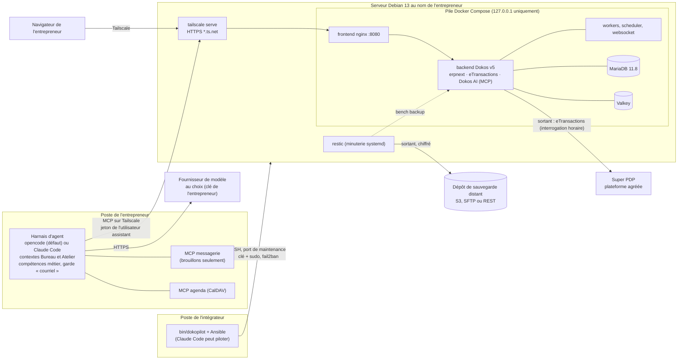

# Architecture

DokoPilot V2 n'ajoute aucun logiciel métier : il assemble des briques existantes et les installe de façon reproductible. Ce document dit ce qui tourne où et comment les briques se parlent. Les raisons des choix sont dans [decisions.md](decisions.md).

## Les briques

| Brique | Rôle | Version | Où |
| --- | --- | --- | --- |
| Dokos (erpnext), Dodock | ERP : comptabilité, ventes, achats, stock, tiers | image officielle v5.18.11, figée par empreinte | conteneurs `backend`, `queue-*`, `scheduler` |
| eTransactions | Réception et émission des factures électroniques par Super PDP | celle de l'image officielle | même conteneur |
| Dokos AI | Serveur MCP (`/api/method/dokos_ai.mcp.endpoint`), journal d'audit, pipelines | v1.14.0, ajoutée à l'image | même conteneur |
| MariaDB, Valkey | Base de données, cache et files de tâches | 11.8 LTS, 8 | conteneurs internes, jamais publiés |
| Caddy ou `tailscale serve` | Accès à Dokos : Caddy en HTTP sur le réseau local (démo), Tailscale en HTTPS (production) | paquets Debian / Tailscale | hôte |
| nftables, fail2ban, OpenSSH | Pare-feu, protection et accès de maintenance | paquets Debian | hôte |
| restic | Sauvegardes chiffrées, rétention | paquet Debian | hôte |
| opencode, Claude Code | Harnais d'agent, au choix | installés par l'entrepreneur | poste |
| Serveurs MCP messagerie et agenda | Lire les courriels, préparer des brouillons, consulter l'agenda | versions figées | poste, en local (stdio) |

## Les identités

| Identité | Qui | Ce qu'elle peut faire |
| --- | --- | --- |
| Compte de maintenance (Linux) | chaque intervenant de l'intégrateur | SSH par clé, sudo avec mot de passe |
| `Administrator` (Dokos) | réservé aux opérations d'installation | tout ; mot de passe dans les secrets |
| Entrepreneur (Dokos) | le dirigeant | gère son entreprise, **valide** les documents |
| Assistant (Dokos), un par personne | le harnais d'agent de cette personne, par MCP | lire, créer et modifier des brouillons ; jamais valider, annuler, amender ni supprimer |

## Les flux

1. **L'entrepreneur travaille avec son agent** sur son poste. L'agent lit et prépare dans Dokos par MCP, sous l'identité de l'assistant, à travers Tailscale. Toute création ou modification est demandée à l'entrepreneur dans le harnais ; la validation des documents se fait dans Dokos, par l'entrepreneur.
2. **Factures électroniques** : eTransactions interroge Super PDP chaque heure (connexion sortante) et crée les factures fournisseurs reçues ; l'agent les rapproche des commandes et prépare les factures d'achat en brouillon.
3. **Banque** : l'entrepreneur importe ses relevés (OFX, CSV, MT940) dans Dokos ; l'agent propose le rapprochement.
4. **Maintenance** : l'intégrateur lance `bin/dokopilot` depuis son poste ; Ansible se connecte en SSH avec un compte nominatif et applique la configuration décrite dans `clients/<client>/`.
5. **Sauvegardes** : chaque nuit, `bench backup --with-files` puis restic vers un dépôt distant chiffré ; rétention 7 jours, 4 semaines, 12 mois.

## Le dépôt

| Dossier | Contenu |
| --- | --- |
| `bin/dokopilot` | La commande unique (initialisation, installation, contrôles, sauvegarde, restauration, harnais, secrets) |
| `config/` | Référence commentée de la configuration d'un client et modèle des secrets |
| `clients/` | Un dossier par client ; seul `demo` est versionné |
| `ansible/` | Rôles et playbooks ; le rôle `config` fusionne les valeurs par défaut, le profil et la configuration du client dans `dp` et les valide |
| `stack/` | Image Dokos dérivée et scripts de provisionnement exécutés dans le conteneur |
| `demo/` | Données de test de l'« Atelier Démo » |
| `harness/` | Modèles opencode et Claude Code, agents, garde, compétences métier |
| `vm/` | Création de la VM locale de test |
| `tests/` | Tests de configuration, des rôles système, de la pile Dokos et du harnais |
