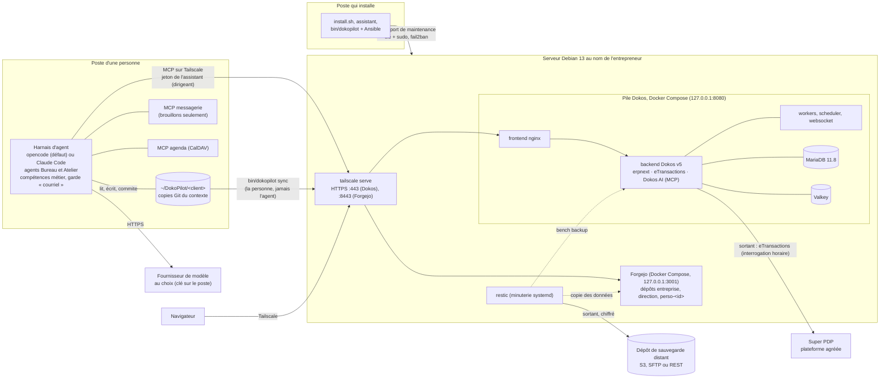

# Architecture

DokoPilot V2 n'ajoute aucun logiciel métier : il assemble des briques existantes et les installe de
façon reproductible. Ce document dit ce qui tourne où et comment les briques se parlent. Les
raisons des choix sont dans [decisions.md](decisions.md), les contrats de la version 0.2 dans
[plan-v0.2.md](plan-v0.2.md).



Le schéma montre la production (`network.mode: tailscale`). En démonstration (`lan`), Caddy
remplace `tailscale serve` : Dokos en HTTP sur le port 80, Forgejo sur le port 3000, depuis les
plages privées de `network.lan.allowed_cidrs` seulement.

## Les briques

| Brique | Rôle | Version | Où |
| --- | --- | --- | --- |
| Dokos (erpnext), Dodock | ERP : comptabilité, ventes, achats, stock, tiers | image officielle v5.18.11, figée par empreinte | conteneurs `backend`, `queue-*`, `scheduler` |
| eTransactions | Réception et émission des factures électroniques par Super PDP | celle de l'image officielle | même conteneur |
| Dokos AI | Serveur MCP (`/api/method/dokos_ai.mcp.endpoint`), journal d'audit, pipelines | v1.14.0, ajoutée à l'image | même conteneur |
| MariaDB, Valkey | Base de données, cache et files de tâches | 11.8 LTS, 8 | conteneurs internes, jamais publiés |
| Forgejo | Serveur Git des dépôts de contexte, interface de relecture | 17.0.1 (image `-rootless`, figée par empreinte), base SQLite | conteneur `forgejo`, projet `/opt/dokopilot/forgejo`, publié sur `127.0.0.1:3001` |
| Caddy ou `tailscale serve` | Accès à Dokos et à Forgejo : Caddy en HTTP sur le réseau local (ports 80 et 3000), Tailscale en HTTPS (ports 443 et 8443) | paquets Debian / Tailscale | hôte |
| nftables, fail2ban, OpenSSH | Pare-feu, protection et accès de maintenance | paquets Debian | hôte |
| restic | Sauvegardes chiffrées de Dokos et de Forgejo, rétention | paquet Debian | hôte |
| opencode, Claude Code | Harnais d'agent, au choix | installés par la personne | poste |
| Serveurs MCP messagerie et agenda | Lire les courriels, préparer des brouillons, consulter l'agenda | versions figées | poste, en local (stdio) |

## Les identités

| Identité | Qui | Ce qu'elle peut faire |
| --- | --- | --- |
| Compte de maintenance (Linux) | chaque intervenant ; en mode « tout sur cette machine », votre propre compte | SSH par clé, sudo avec mot de passe |
| `Administrator` (Dokos) | réservé aux opérations d'installation | tout ; mot de passe dans les secrets |
| Entrepreneur (Dokos) | le dirigeant | gère son entreprise, **valide** les documents |
| Assistant (Dokos) | le harnais du dirigeant, par MCP ; en version 0.2, seul le dirigeant a un assistant dans Dokos ([D-29](decisions.md)) | lire, créer et modifier des brouillons ; jamais valider, annuler, amender ni supprimer |
| `dokopilot-admin` (Forgejo) | réservé aux opérations d'installation | administre Forgejo ; mot de passe dans les secrets |
| Personne (Forgejo), compte `<id>` | chaque personne de `users.people` | lit et écrit ses dépôts (voir plus bas) ; son jeton sert à `bin/dokopilot sync` |
| Assistant (Forgejo), compte `assistant-<id>` | l'agent de la personne ; ses commits sont signés « Assistant de <Prénom> » | compte restreint : ne voit que les dépôts qui lui sont donnés, en écriture |

## Le contexte de l'entreprise (Forgejo)

Le contexte est le savoir écrit de l'entreprise, en Markdown, versionné dans Git. Git ne gère pas
la lecture fichier par fichier : il y a donc un dépôt par périmètre de droits
([D-20](decisions.md)), dans l'organisation `<client.id>` de Forgejo.

| Dépôt | Qui lit et écrit | Ce qu'il contient |
| --- | --- | --- |
| `<client>/entreprise` | équipe `membres` : toutes les personnes et leurs assistants | `AGENTS.md` (les huit règles), `CLAUDE.md`, `entreprise.md`, `00-Boite-de-reception/` à `90-Modeles/` (dont les huit fonctions de `50-Fonctions/` et la description des sources de données dans `60-Donnees/`), puis les procédures que l'entreprise écrit (`.agents/skills/`) |
| `<client>/direction` (si `context.direction`) | équipe `direction` : le dirigeant et son assistant | `AGENTS.md` (confidentialité renforcée), `rh/`, `remunerations/`, `strategie/`, `juridique/` |
| `<client>/perso-<id>` (un par personne) | la personne (administratrice du dépôt) et son assistant | `AGENTS.md` (préférences de la personne), `memoire-vive.md`, `00-Boite-de-reception/`, `40-Projets/` |

Personne d'autre, hormis `dokopilot-admin`, n'a de droit : un membre ne lit ni `direction` ni le
`perso` d'un autre, et `bin/dokopilot check` le vérifie compte par compte. Les équipes écrivent
dans le code, les tickets, les demandes de fusion et le wiki de leurs dépôts. Les huit règles
d'`AGENTS.md` sont résumées dans [plan-v0.2.md](plan-v0.2.md) (C-3) ; leur texte est dans
[`context/entreprise/AGENTS.md.j2`](../context/entreprise/AGENTS.md.j2).

Le contenu initial vient des modèles de [`context/`](../context/) (plus un contenu d'exemple en
démonstration). Il n'est déposé, en un premier commit signé « DokoPilot », que dans un dépôt
**vide** ; un dépôt qui a déjà un commit n'est jamais modifié ([D-28](decisions.md)). Ensuite, le
contexte appartient à l'entreprise.

## Le poste : l'espace de travail

`bin/dokopilot harness <client> [--person <id>]` prépare le poste d'une personne :

```text
~/DokoPilot/<client>/            copie de <client>/entreprise : le dossier de travail de l'agent
├── AGENTS.md, CLAUDE.md, 00-… à 90-…
├── direction/                   copie de <client>/direction (dirigeant seulement)
├── perso/                       copie de <client>/perso-<id>
└── opencode.json, .claude/, …   fichiers du harnais, ignorés par Git
~/.config/dokopilot/<client>/    jeton Git, mot de passe Forgejo initial, clé du modèle, jeton
                                 Dokos (dirigeant) : fichiers 0600, hors du dossier de travail
```

Le harnais du dirigeant parle aussi à Dokos par MCP, sous l'identité de son assistant ; celui
d'un membre n'a pas accès à Dokos en version 0.2. Détails :
[poste-entrepreneur.md](poste-entrepreneur.md).

## Le flux du contexte

L'agent propose, la personne valide et envoie ([D-21](decisions.md)) :

```text
  Poste de la personne                             Serveur
 +-------------------------------------+           +-------------------------+
 | agent (Bureau ou Atelier)           |           | Forgejo                 |
 |  1. écrit : libre dans la boîte de  |           |  <client>/entreprise    |
 |     réception et perso/, sur accord |           |  <client>/direction     |
 |     ailleurs                        |           |  <client>/perso-<id>    |
 |  2. git commit, auteur              |           |                         |
 |     « Assistant de <Prénom> »       |           |                         |
 |     (jamais de git push)            |           |                         |
 |                                     |           |                         |
 | la personne relit (git log -p),     |  3. sync  |                         |
 | puis : bin/dokopilot sync <client>  | --------> |                         |
 +-------------------------------------+           +-------------------------+
   sync : contrôle de chaque copie, git pull --rebase, puis git push,
   avec le jeton de la personne
```

`bin/dokopilot sync` vérifie la configuration Git de chaque copie avant d'envoyer quoi que ce
soit ([securite.md](securite.md#lagent-ne-pousse-jamais)). Les autres personnes reçoivent les
changements à leur prochain `sync` (ou `harness`, qui met à jour une copie propre en avance
rapide).

## Les flux

1. **Une personne travaille avec son agent** sur son poste, dans son espace de travail. L'agent
   du dirigeant lit et prépare dans Dokos par MCP, sous l'identité de l'assistant, à travers
   Tailscale. Toute création ou modification est demandée dans le harnais ; la validation des
   documents se fait dans Dokos, par une personne.
2. **Contexte** : l'agent écrit et commite dans les copies Git du poste ; la personne envoie avec
   `bin/dokopilot sync` (schéma ci-dessus).
3. **Factures électroniques** : eTransactions interroge Super PDP chaque heure (connexion
   sortante) et crée les factures fournisseurs reçues ; l'agent les rapproche des commandes et
   prépare les factures d'achat en brouillon.
4. **Banque** : l'entrepreneur importe ses relevés (OFX, CSV, MT940) dans Dokos ; l'agent propose
   le rapprochement.
5. **Maintenance** : `bin/dokopilot` applique la configuration décrite dans `clients/<client>/`,
   par Ansible, avec un compte nominatif (SSH, ou connexion locale en mode « tout sur cette
   machine »).
6. **Sauvegardes** : chaque nuit, `bench backup --with-files`, puis une copie des données de
   Forgejo (service arrêté quelques secondes), puis restic vers le dépôt chiffré ; rétention
   7 jours, 4 semaines, 12 mois ([exploitation.md](exploitation.md)).

## Mode « tout sur cette machine » et mode distant

| | Tout sur cette machine (`server.local: true`) | Serveur distant |
| --- | --- | --- |
| Machines | Une Debian 13 amd64, serveur et poste à la fois | Un serveur Debian 13 amd64 et un poste Debian, Ubuntu ou Fedora (WSL compris) |
| Connexion d'Ansible | Locale (`--local`), sans SSH vers soi-même | SSH, avec le compte de maintenance |
| Compte de maintenance | Le compte qui lance le script ; mot de passe inchangé, demandé par sudo (`-K`) | Créé par `bootstrap` ; mot de passe sudo dans les secrets |
| Accès en mode `lan` | `http://localhost` et `http://localhost:3000/` sur la machine, `http://<IP>` et `http://<IP>:3000/` depuis le réseau local | `http://<adresse>` et `http://<adresse>:3000/` |
| Harnais | Sur cette machine, pour le même compte | Sur le poste de chaque personne |

Dans les deux modes, le serveur est durci de la même façon (pare-feu, SSH par clé, fail2ban), et
le durcissement ne coupe pas la session locale ([securite.md](securite.md)).

## Le dépôt

La carte des dossiers du dépôt DokoPilot est dans le [README](../README.md#le-dépôt).
